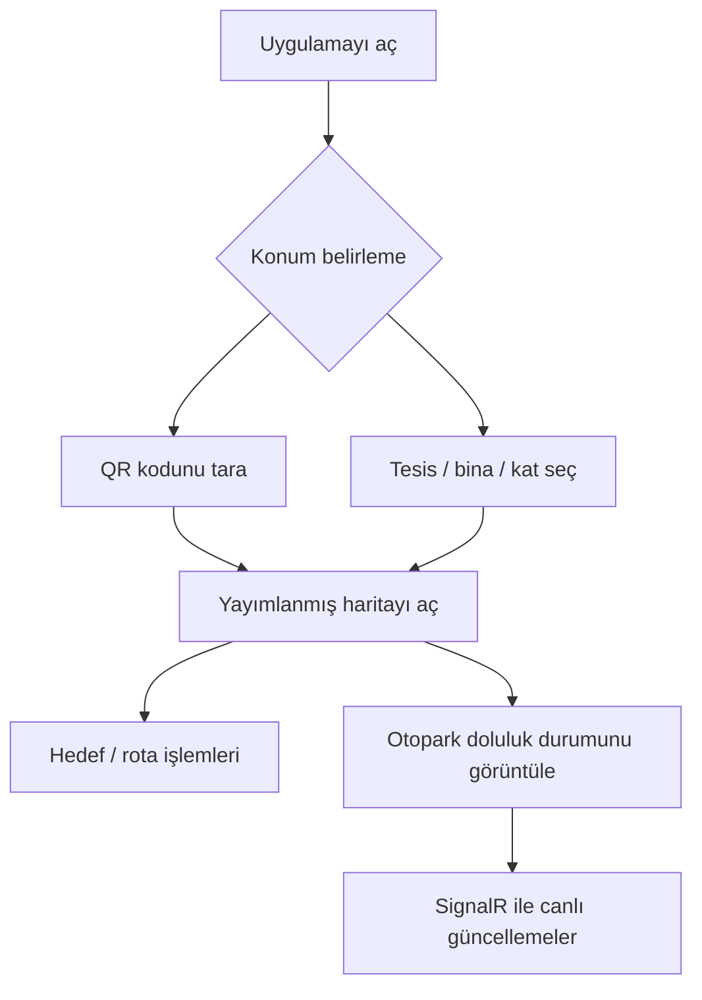

<div align="center">

# 📱 Bulocation Mobile

### QR kodla konumunu belirle, kat planını görüntüle, hedefe rota oluştur.

[](https://flutter.dev/)
[](https://dart.dev/)
[](https://developer.android.com/)
[](https://developer.apple.com/)

**[Web Sitesi](https://bulocation.com)** · **[Backend API](https://github.com/mikdatkerem/bulocation-api)** · **[Web Yönetim Paneli](https://github.com/mikdatkerem/bulocation-landing-page)**

</div>

---

## 🎯 Proje Hakkında

**Bulocation Mobile**, alışveriş merkezleri, hastaneler, otoparklar ve benzeri karmaşık kapalı alanlarda navigasyon deneyimi sunmak için geliştirilen **Flutter** uygulamasıdır.

Temel fikir basit: Kullanıcı bulunduğu noktadaki **QR kodu okutur** veya konumunu **tesis / bina / kat seçerek** belirler. Ardından yayımlanmış kat haritasını görüntüler ve hedef noktaya giden rotayı takip edebilir.

Otopark doluluk takibi, platformun sunduğu kullanım alanlarından **biridir**; Bulocation yalnızca bir otopark uygulaması değildir.

## ✨ Temel Özellikler

| Özellik | Açıklama |
| --- | --- |
| 📷 **QR kod ile başlama** | Kamerayla QR tarayarak ilgili alanın harita bağlamını açma |
| 🏢 **Manuel konum seçimi** | Organizasyon, yerleşke, bina ve kat seçimi |
| 🗺️ **Kat planı görüntüleme** | Yayımlanmış harita varlıklarını uygulamada görüntüleme |
| 🧭 **Rota çizimi** | Harita üzerinde hedefe yönelik rota oluşturma/gösterme |
| 🅿️ **Canlı park doluluğu** | SignalR ile park noktası durum değişikliklerini alma |
| 🕘 **Son haritalar** | Daha önce açılan haritalara hızlı erişim |
| 🔎 **Akıllı seçim akışı** | Yerleşke, bina ve kat aramalarında son kullanılanların öne çıkması |
| 🔐 **Hesap yönetimi** | Giriş, kayıt, oturum yenileme ve profil işlemleri |
| 🌐 **Google ile giriş** | Gerekli sunucu istemci kimliği yapılandırıldığında Google oturum açma |

## 🖼️ Uygulama Ekranları

Ekran görüntüleri henüz eklenmedi. Hazır olduklarında `screenshots/` klasörüne yerleştirip aşağıdaki yorum bloğunu açabilirsiniz.

<!--
<div align="center">

| Ana Sayfa | QR Tarayıcı | Harita / Rota |
|:---:|:---:|:---:|
|  |  |  |

| Tesis Seçimi | Otopark | Profil |
|:---:|:---:|:---:|
|  |  |  |

</div>
-->

## 🔄 Kullanıcı Akışı



## 🧰 Kullanılan Teknolojiler

- **Flutter / Dart 3** — Android ve iOS uygulama geliştirme
- **Dio / HTTP** — Bulocation API ile veri alışverişi
- **mobile_scanner** — QR kod tarama
- **flutter_svg** — SVG tabanlı kat planları ve görseller
- **SignalR (`signalr_netcore`)** — gerçek zamanlı park durumu güncellemeleri
- **flutter_secure_storage** — güvenli yerel oturum bilgileri
- **shared_preferences** — uygulama tercihleri ve son kullanılan haritalar
- **google_sign_in** — Google oturum açma entegrasyonu

## ⚙️ Kurulum

### Gereksinimler

- Flutter SDK (Dart 3.x uyumlu)
- Android Studio ve Android SDK; iOS için macOS + Xcode
- Çalışan bir [Bulocation API](https://github.com/mikdatkerem/bulocation-api) örneği

**1. Depoyu klonlayın**

```bash
git clone https://github.com/mikdatkerem/bulocation-mobile-app.git
cd bulocation-mobile-app
```

**2. Paketleri kurun**

```bash
flutter pub get
```

**3. Android emülatöründe çalıştırın**

```bash
flutter run --dart-define=BASE_HOST=http://10.0.2.2:5011
```

`10.0.2.2`, Android emülatöründen geliştirme bilgisayarının `localhost` adresine erişim içindir. Gerçek cihazda cihazın erişebildiği API adresini kullanmanız gerekir.

### Yapılandırma

Yapılandırma `--dart-define` ile aktarılır:

| Değişken | Açıklama |
| --- | --- |
| `BASE_HOST` | API ana adresi; REST `/api` ve SignalR `/hubs/parking` yolları bundan türetilir |
| `APP_SECRET` | Bazı API/gateway akışlarında kullanılan isteğe bağlı uygulama başlığı |
| `GOOGLE_SERVER_CLIENT_ID` | Google ile giriş için sunucu istemci kimliği |

Örnek HTTPS ortamı:

```bash
flutter run --dart-define=BASE_HOST=https://api.bulocation.com
```

> **Güvenlik:** Bir mobil uygulamaya gömülen `APP_SECRET` gerçek anlamda gizli tutulamaz. Yetki kontrolünün temeli sunucu tarafındaki doğrulama ve JWT oturum mekanizması olmalıdır. Gerçek anahtarları Git'e eklemeyin.

## 📁 Proje Yapısı

```text
bulocation-mobile-app/
├── lib/
│   ├── app/                # Oturum / uygulama durumu
│   ├── core/               # API istemcisi
│   ├── models/             # Veri modelleri
│   ├── screens/            # Giriş, ana sayfa, harita, profil
│   ├── services/           # Auth, tesis, rota, park servisleri
│   ├── widgets/            # QR, kat planı, panel bileşenleri
│   └── main.dart
├── assets/                 # Uygulama görselleri
├── android/
├── ios/
├── test/
└── pubspec.yaml
```

## 🧪 Test ve Kalite

```bash
flutter analyze
flutter test
```

### Android sürüm paketi

Release paketi üretmeden önce `android/key.properties` ve gerçek imzalama anahtarı yapılandırılmalıdır. Depodaki `android/key.properties.example` örnek olarak kullanılabilir; şifreler ve anahtar dosyası repoya eklenmemelidir.

```bash
flutter build apk --release --dart-define=BASE_HOST=https://api.bulocation.com
```

> Release modunda `BASE_HOST` için HTTPS zorunludur. Android/iOS mağaza yayınından önce imzalama, Google oturum açma ayarları ve gerçek cihaz testleri tamamlanmalıdır.

## 🔗 Bulocation Ekosistemi

| Depo | Sorumluluk |
| --- | --- |
| [bulocation-api](https://github.com/mikdatkerem/bulocation-api) | Backend, haritalar, kimlik doğrulama, rota ve SignalR |
| [bulocation-landing-page](https://github.com/mikdatkerem/bulocation-landing-page) | Tanıtım sitesi ve yönetim paneli |
| **bulocation-mobile-app** | QR tabanlı mobil navigasyon uygulaması |

## 📄 Lisans

Bu depoda açık bir lisansın varlığı doğrulanmadı. Kullanım ve yeniden dağıtım koşulları ayrıca tanımlanmalıdır.

---

<div align="center">

**Bulocation — Gideceğiniz yeri bulmak artık daha kolay.**

Geliştirici: [Mikdat Kerem Kalkan](https://github.com/mikdatkerem)

</div>
